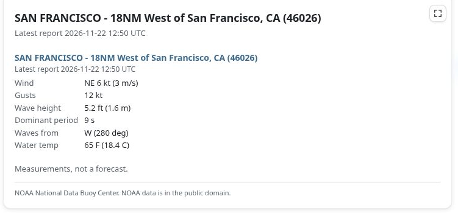

# Coastal Conditions

Find the next low tide and see what a nearby buoy actually measured. Coastal Conditions puts station-local tide times, wind, wave height, and water temperature in one briefing, with a source and timestamp for each.

[Connect with Claude, ChatGPT, Muse Code, or Grok](PROVIDERS.md)

## Try it

- When is low tide at Cape May tomorrow, and what has the nearest buoy reported about waves?
- Compare the latest observed conditions at two NOAA stations near Monterey Bay.

## Install in Claude

In Claude Code, run the following commands.

```text
/plugin marketplace add OpZero-sh/plugins
/plugin install coastal-conditions@opzero
```

In Claude chat or Cowork, open the installed plugin’s **Connectors** tab and connect the listed services. The hosted services use public data and require no sign-in. Then ask a question or use the `coastal-brief` skill. In Cowork or Claude Code, the `station-pairing` agent can handle a deeper comparison.

## Sources and coverage

NOAA CO-OPS supplies local astronomical predictions and NDBC supplies station measurements. Tide heights use mean lower low water. Some buoys lack a wave sensor. Buoy data describes the observation time and can differ from conditions at shore.

In Claude Code, an optional Node.js hook flags a buoy report at least six hours old and gives its age. The skill also reads observation times directly in chat.

- [tide-times](https://tide-times.mcp.opzero.sh/) · [Privacy](https://tide-times.mcp.opzero.sh/?page=privacy) · [Support](https://tide-times.mcp.opzero.sh/?page=support)
- [marine-conditions](https://marine-conditions.mcp.opzero.sh/) · [Privacy](https://marine-conditions.mcp.opzero.sh/?page=privacy) · [Support](https://marine-conditions.mcp.opzero.sh/?page=support)

## In use

Examples from the connected services in Claude.



- [A one-day tide prediction for San Francisco](media/tide-prediction.webp)
