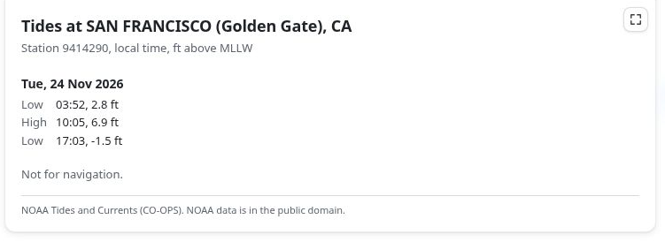

# Coastal Conditions

Find the next low tide and see what a nearby buoy actually measured. Coastal Conditions puts tide times local to the station, wind, wave height, and water temperature in one briefing, with a source and timestamp for each.

[Connect with Claude, ChatGPT, Muse Code, or Grok](PROVIDERS.md)

## Try it

- When is low tide at Cape May tomorrow, and what has the nearest buoy reported about waves?
- Compare the latest observed conditions at two NOAA stations near Monterey Bay.

## Install in Claude

In Claude Code, run the following commands.

```text
/plugin marketplace add OpZero-sh/plugins
/plugin install coastal-conditions@opzero
```

In Claude chat or Cowork, open the installed plugin’s **Connectors** tab and connect the listed services. The hosted services use public data and require no sign in. Then ask a question or name a skill.

## Skills

Each skill is a set of written instructions that Claude loads when a request matches it. Reference notes sit beside each skill and are read only when needed.

- `tide-lookup` finds a NOAA tide station and returns predicted highs and lows for one to seven days, with heights above mean lower low water and times local to the station.
- `buoy-report` finds a NOAA buoy or shore station and reads its latest measured wind, gusts, waves, wave period, temperatures and pressure, with the report time and its age.
- `coastal-brief` pairs a tide station with one or two weather stations for the same stretch of coast and reports predictions and measurements side by side.

## Agent

In Cowork or Claude Code, the `station-pairing` agent matches several spots to representative stations and explains each choice. It can call only the four read only tools of the two services listed below.

## Hooks

None. This plugin has no hooks and runs no code on your machine. The `buoy-report` skill tells Claude to read the report time itself, state the age of an older report and call a reading stale when it is six hours old or more.

## Sources and coverage

NOAA CO-OPS supplies astronomical tide predictions for US coasts and territories. NOAA NDBC supplies station measurements. Tide heights use mean lower low water. Predictions leave out wind, pressure and storm surge, and the plugin does not fetch observed water levels or currents. Some stations lack a wave sensor. A buoy reading describes the station at the report time and can differ from conditions at shore.

This plugin reports data. It is not a marine forecast and carries no advisories or warnings. Before going on the water, check the [National Weather Service marine forecast](https://www.weather.gov/marine) and ask local lifeguards or the harbor master. In an emergency in the US, call 911 or hail the Coast Guard on VHF channel 16.

## What this plugin runs, sends and fetches

The plugin connects Claude to two hosted services over HTTPS. A request carries only what the question needs: a place name or latitude and longitude, a station id, a date and a unit choice. The services read NOAA data on their side and state that requests are not stored.

- [tide-times](https://tide-times.mcp.opzero.sh/) at `tide-times.mcp.opzero.sh` · [Privacy](https://tide-times.mcp.opzero.sh/?page=privacy) · [Support](https://tide-times.mcp.opzero.sh/?page=support)
- [marine-conditions](https://marine-conditions.mcp.opzero.sh/) at `marine-conditions.mcp.opzero.sh` · [Privacy](https://marine-conditions.mcp.opzero.sh/?page=privacy) · [Support](https://marine-conditions.mcp.opzero.sh/?page=support)

The plugin starts no local process. The two services are declared in `.mcp.json`.

The repository also holds configuration files for other clients. The plugin never runs them. The two scripts that read them are not in this repository. They live in the catalog repository, https://github.com/OpZero-sh/plugins, and do something only if you clone it and run them yourself.

- `tools/build_openai.py` in the catalog reads files in a checkout of this repository and writes ZIP packages to the folder you name. It makes no network request.
- `tools/grok_example.py` in the catalog prints a request preview when run with `--dry-run`. Without that flag it reads `XAI_API_KEY`, and `XAI_MODEL` if set, from your environment and sends your question and the two service URLs to the xAI API at `api.x.ai`.
- `integrations/grok-servers.json` and the `integrations/openai` folder are configuration read by those two scripts.

## In use

Examples from the connected services in Claude.



